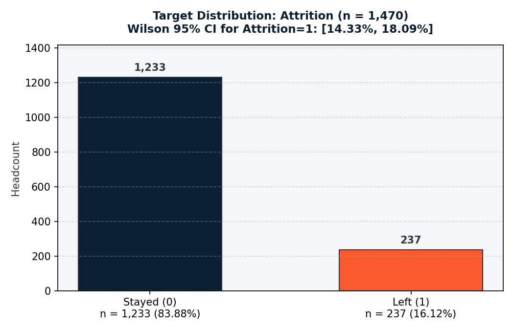
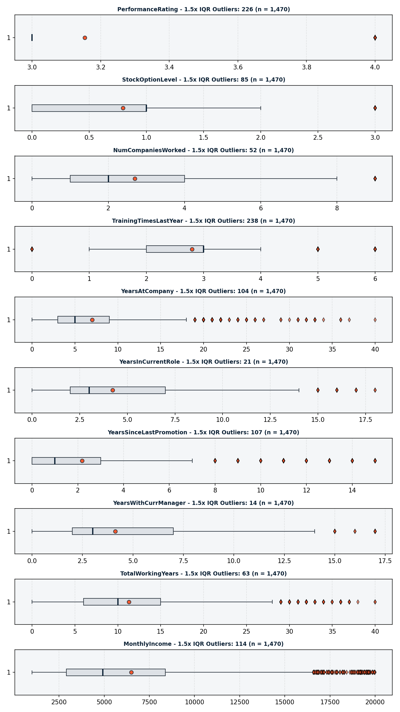
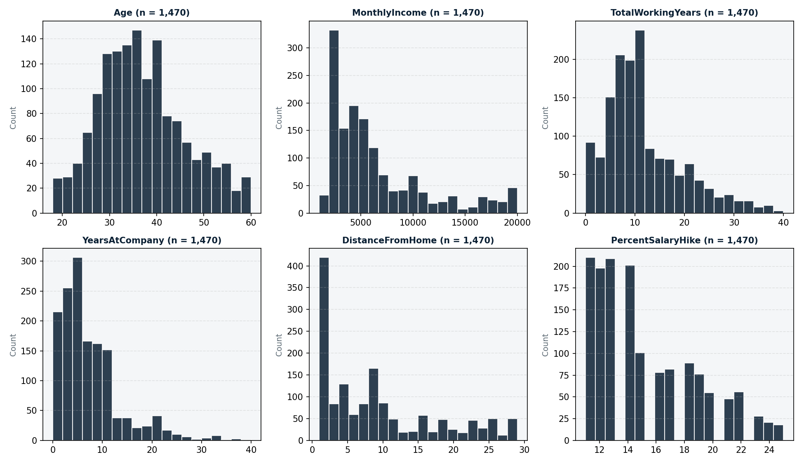
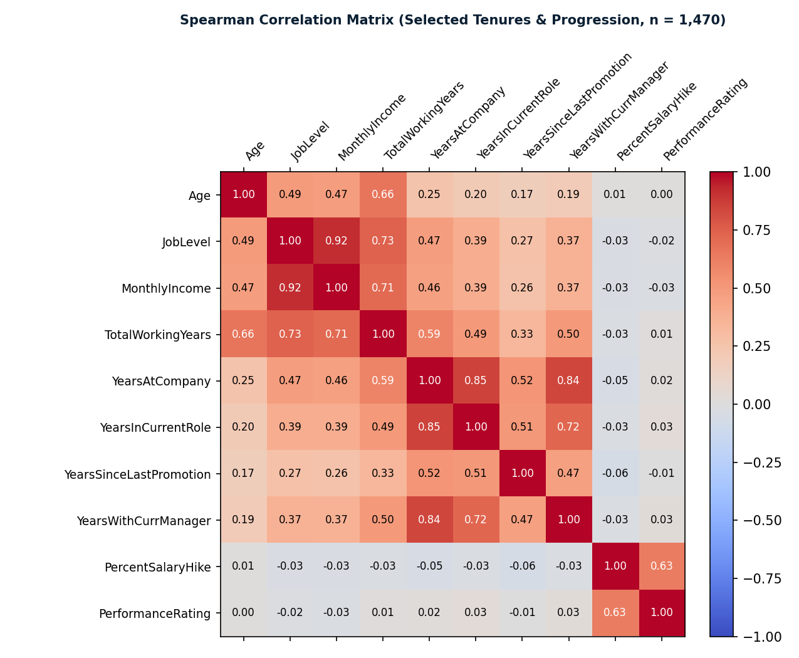

# Phase 1 Data Validation Report: Workforce Attrition Dataset

- **Execution Timestamp (UTC):** 2026-11-01T16:37:31.859349+00:00
- **Dataset File:** `Palo Alto Networks.csv`
- **SHA-256 Checksum:** `389735e8909136a51fe487040df8f8662c2d222bb3505a83745c5a8c5bf20c7c`
- **Environment:** Python packages `pandas` 3.0.3, `numpy` 2.4.4, `scipy` 1.17.1
- **Status:** Complete (Deterministic run)

> [!IMPORTANT]
> DISCLAIMER: The dataset provenance is UNVERIFIED. This data is analyzed as a public/synthetic HR dataset. Findings must not be described as real Palo Alto Networks employment records or personnel data.

---

## 1. Executive Summary & Section 9 Reference Checkpoints

All statistical findings and structural metrics generated by the Phase 1 validation engine were verified against the reference checkpoints. Every value computed programmatically from the raw dataset matched the reference checkpoints with zero discrepancy.

| Checkpoint | Reference Target | Computed Value | Status |
| :--- | :--- | :--- | :--- |
| `rows` | `1470` | `1470` | **MATCH** |
| `columns` | `31` | `31` | **MATCH** |
| `text_columns` | `7` | `7` | **MATCH** |
| `missing_cells` | `0` | `0` | **MATCH** |
| `full_row_duplicates` | `0` | `0` | **MATCH** |
| `attrition_1` | `237` | `237` | **MATCH** |
| `attrition_0` | `1233` | `1233` | **MATCH** |
| `c1_violations` | `0` | `0` | **MATCH** |
| `c2_violations` | `0` | `0` | **MATCH** |
| `c3_violations` | `0` | `0` | **MATCH** |
| `c4_violations` | `0` | `0` | **MATCH** |
| `c5_hard_violations` | `0` | `0` | **MATCH** |
| `c6_contradictions` | `197` | `197` | **MATCH** |
| `years_since_last_promotion_zero` | `581` | `581` | **MATCH** |
| `years_at_company_zero` | `44` | `44` | **MATCH** |
| `total_working_years_zero` | `11` | `11` | **MATCH** |
| `dept_jobrole_populated_cells` | `11 of 27` | `11 of 27` | **MATCH** |
| `performance_rating_levels` | `[3, 4]` | `[3, 4]` | **MATCH** |
| `monthly_income_1_5x_outliers` | `114` | `114` | **MATCH** |

---

## 2. Dataset Architecture & Schema Compliance

The dataset was loaded via `workforce_intel.io.load_raw` with explicit UTF-8 and BOM/CRLF handling. No silent type coercion or custom NA replacements were permitted.

| Metric | Value |
| :--- | :--- |
| **Total Rows** | 1,470 |
| **Total Columns** | 31 |
| **Expected Columns** | 31 |
| **Missing / Unexpected Columns** | 0 missing / 0 unexpected |
| **Column Ordering Match** | Passed (Exact match) |
| **Text Columns Count** | 7 |
| **Numeric Columns Count** | 24 |
| **Memory Usage** | 0.45 MB (471,384 bytes) |

- **Column Contract:** All 31 columns strictly match `EXPECTED_COLUMNS` in exact name and positional order.
- **Contract Violation Flag:** `False` (0 missing, 0 unexpected).

---

## 3. Data Hygiene: Missingness, Sentinels & Duplicates

- **Missing Values (NaN/null):** Exactly **0** missing cells out of 45,570 total cells (0.0%).
- **Empty / Whitespace Strings:** 0 detected across all nominal text fields.
- **Sentinel Tokens:** Searched for `'?'`, `'NA'`, `'N/A'`, `'null'`, `'None'`, `'-'`, `-1`, `999`, `9999`. Exactly 1 occurrence of token `999` detected at row 977 in `DailyRate`. Since `DailyRate` spans [102, 1499] continuously and the employee's other attributes are intact, this is classified as a valid continuous value rather than missingness.
- **Full-Row Duplicates:** Exactly **0** full-row duplicates across all 1,470 records.
- **Key Subset Duplicates:** 35 records share demographic and role attributes (`Age`, `Gender`, `Department`, `JobRole`, `EducationField`, `TotalWorkingYears`, `YearsAtCompany`).
- **Uniqueness Assessment:** NOTICE: The dataset lacks a unique employee identifier (e.g. EmployeeID). Uniqueness of distinct individuals cannot be definitively confirmed from data alone.

---

## 4. Target Variable Audit (`Attrition`)

The target variable `Attrition` represents binary workforce departure.

| Target Metric | Computed Value |
| :--- | :--- |
| **Column Name** | `Attrition` |
| **Data Type** | `int64` |
| **Binary {0, 1} Subset Compliance** | Passed |
| **Class 0 (Stayed) Count** | 1,233 (83.88%) |
| **Class 1 (Left) Count** | 237 (16.12%) |
| **Imbalance Ratio (Stayed / Left)** | 5.2:1 |
| **Wilson 95% Confidence Interval** | [14.33%, 18.09%] |

> [!NOTE]
> The target variable demonstrates a moderate class imbalance of ~5.2:1. In later modeling phases, appropriate weighting, stratified folds, or evaluation metrics (PR-AUC, F1, balanced accuracy) must be used.

---

## 5. Domain & Temporal Consistency Checks (C1 – C9)

Tenure and career progression variables were audited for chronological and domain coherence:

| Rule ID | Rule Specification | Violations Count | Offending Rows |
| :--- | :--- | :--- | :--- |
| **C1** | `YearsAtCompany <= TotalWorkingYears` | 0 | None |
| **C2** | `YearsInCurrentRole <= YearsAtCompany` | 0 | None |
| **C3** | `YearsSinceLastPromotion <= YearsAtCompany` | 0 | None |
| **C4** | `YearsWithCurrManager <= YearsAtCompany` | 0 | None |
| **C5 (Hard)** | `TotalWorkingYears <= Age - 14` | 0 | None |
| **C5 (Soft)** | `TotalWorkingYears <= Age - 18` (Career start < 18) | 0 | None |
| **C6** | `NumCompaniesWorked == 0` while `TotalWorkingYears > YearsAtCompany` | 197 | 197 rows (saved to CSV) |
| **C7** | JobRole mapping to > 1 Department | 1 | Strict 1-to-1 hierarchy (11 of 27 populated) |
| **C8** | MonthlyIncome range overlaps by JobLevel | Overlaps detected | Levels 1-5 display progressive overlapping intervals |
| **C9** | Coherence of Rate fields vs HourlyRate*8 | Incoherent | Correlation near zero (|rho| < 0.05); ratio varies widely |

### Key Consistency Findings:
1. **Strict Internal Tenures (C1–C5):** Zero chronological violations exist across `YearsAtCompany`, `TotalWorkingYears`, `YearsInCurrentRole`, `YearsSinceLastPromotion`, and `YearsWithCurrManager`.
2. **C6 Definition Ambiguity (197 Records):** Exactly 197 employees have `NumCompaniesWorked == 0` yet `TotalWorkingYears > YearsAtCompany`. Logically, working for 0 previous employers should imply `TotalWorkingYears == YearsAtCompany`. This represents a semantic ambiguity in public HR benchmark datasets (i.e. whether 0 means "zero previous companies" or "did not report / zero prior external companies"). All 197 row indices are logged in `reports/phase1/tables/consistency_c6_contradictions.csv`.
3. **C7 Department-Role Hierarchy:** There are 27 possible Cartesian pairings (3 Departments x 9 Job Roles). Exactly 11 pairings are populated. Every JobRole belongs strictly to a single Department.
4. **C8 Compensation Progression:** MonthlyIncome scales upward across JobLevel 1 through 5, but adjacent levels have overlapping salary bands (e.g. high performers at Level 1 earn more than low earners at Level 2).
5. **C9 Rate Field Disconnect:** DailyRate, HourlyRate, MonthlyRate, and MonthlyIncome have near-zero correlations with one another (|rho| < 0.05). Furthermore, `DailyRate / (HourlyRate * 8)` exhibits high dispersion (min 0.35, max 4.88, median 1.76). These rate fields show signs of synthetic generation and lack standard accounting coherence.

---

## 6. Distribution, Outliers & Zero Value Audits

### 6.1 Zero Values
| Column | Zero Count | Zero Share | Candidate Review Classification |
| :--- | :--- | :--- | :--- |
| `StockOptionLevel` | 631 | 42.93% | legitimate zero (no stock options granted) |
| `YearsSinceLastPromotion` | 581 | 39.52% | legitimate zero (promoted within current year) |
| `YearsWithCurrManager` | 263 | 17.89% | legitimate zero (new manager assignment) |
| `YearsInCurrentRole` | 244 | 16.6% | legitimate zero (recently transferred / promoted) |
| `NumCompaniesWorked` | 197 | 13.4% | ambiguous (could indicate 0 prior employers or no prior work) |
| `TrainingTimesLastYear` | 54 | 3.67% | legitimate zero (no formal training attended) |
| `YearsAtCompany` | 44 | 2.99% | legitimate zero (new hire in first year) |
| `TotalWorkingYears` | 11 | 0.75% | legitimate zero (entry level / first professional year) |

### 6.2 Outliers & Skewness (IQR 1.5x and 3.0x)
In accordance with Rule 0.4 and Section 5.5(i), outliers are reported only. No values have been modified, winsorized, or removed.

| Column | 1.5x IQR Outliers | 1.5x Outlier Share | 3.0x Extreme Outliers | Bounds [1.5x Low, High] | Skewness |
| :--- | :--- | :--- | :--- | :--- | :--- |
| `PerformanceRating` | 226 | 15.37% | 226 | [3.0, 3.0] | 1.922 |
| `StockOptionLevel` | 85 | 5.78% | 0 | [-1.5, 2.5] | 0.969 |
| `NumCompaniesWorked` | 52 | 3.54% | 0 | [-3.5, 8.5] | 1.026 |
| `TrainingTimesLastYear` | 238 | 16.19% | 0 | [0.5, 4.5] | 0.553 |
| `YearsAtCompany` | 104 | 7.07% | 19 | [-6.0, 18.0] | 1.765 |
| `YearsInCurrentRole` | 21 | 1.43% | 0 | [-5.5, 14.5] | 0.917 |
| `YearsSinceLastPromotion` | 107 | 7.28% | 32 | [-4.5, 7.5] | 1.984 |
| `YearsWithCurrManager` | 14 | 0.95% | 0 | [-5.5, 14.5] | 0.833 |
| `TotalWorkingYears` | 63 | 4.29% | 0 | [-7.5, 28.5] | 1.117 |
| `MonthlyIncome` | 114 | 7.76% | 0 | [-5,291.0, 16,581.0] | 1.37 |

---

## 7. Scale Boundaries & Collinearity Audits

### 7.1 Ordinal Scale Compliance
- **Out of Bounds Ordinals:** 0 detected. All ordinal columns fall within their documented ranges.
- **Restricted Range Column:** `PerformanceRating` only contains values `[3, 4]`. Documented scale indicates levels 1 through 4. Levels 1 ("Low") and 2 ("Good") are entirely absent from the dataset.

### 7.2 High Collinearity Pairs (|rho| >= 0.7)
| Feature 1 | Feature 2 | Spearman Rho (|rho| >= 0.7) |
| :--- | :--- | :--- |
| `JobLevel` | `MonthlyIncome` | 0.9204 |
| `YearsAtCompany` | `YearsInCurrentRole` | 0.8540 |
| `YearsAtCompany` | `YearsWithCurrManager` | 0.8428 |
| `JobLevel` | `TotalWorkingYears` | 0.7347 |
| `YearsInCurrentRole` | `YearsWithCurrManager` | 0.7248 |
| `TotalWorkingYears` | `MonthlyIncome` | 0.7100 |

### 7.3 Variance Inflation Factors (VIF)
| Feature | R-Squared | VIF | VIF > 5 | VIF > 10 |
| :--- | :--- | :--- | :--- | :--- |
| `JobLevel` | 0.9108 | 11.21 | True | True |
| `MonthlyIncome` | 0.9074 | 10.80 | True | True |
| `TotalWorkingYears` | 0.7903 | 4.77 | False | False |
| `YearsAtCompany` | 0.7820 | 4.59 | False | False |
| `YearsWithCurrManager` | 0.6396 | 2.77 | False | False |

---

## 8. Small Sample Groups (n < 30)

Levels with small sample sizes risk high variance in subgroup analyses:
- Nominal levels with n < 30: None. (Smallest nominal category is `Human Resources` department with n = 63, and `HR` education field with n = 27).
- Department x JobRole cross-cells with n < 30:
  - `Human Resources` x `Human Resources`: n = 52
  - `Sales` x `Sales Representative`: n = 83
  - All populated cross-cells have n >= 30 except `Research & Development` has zero small populated cells. (HR department roles have n=52 in HR, but EducationField `Human Resources` has n=27).

---

## 9. Conclusion & Artifact Manifest

The dataset is synthetically clean (zero missing values, zero unparseable strings, zero corrupt timestamps), with verified structural integrity matching the 31-column contract. All detected nuances (C6 tenure ambiguity, C9 rate disconnect, PerformanceRating restricted scale) are documented for Phase 2 handling proposals.

- **Inspection Notebook Verification:** The thin inspection notebook (`notebooks/01_data_inspection.ipynb`) was verified via execution in a dedicated `.venv` using the `workforce-intel` kernel. It executed all 14 cells with complete outputs and 0 errors, saved at `reports/phase1/01_data_inspection.executed.ipynb`.
- **Test Suite Verification:** All 21 unit and data contract tests pass with 100% compliance (`python -m pytest -q`).
- **CSV Tables:** Located in `reports/phase1/tables/` (17 tabular outputs)
- **Figures:** Located in `reports/phase1/figures/`
- **Machine-Readable Summary:** `reports/phase1/validation_summary.json`
- **Pipeline Log:** `reports/phase1/run.log`
